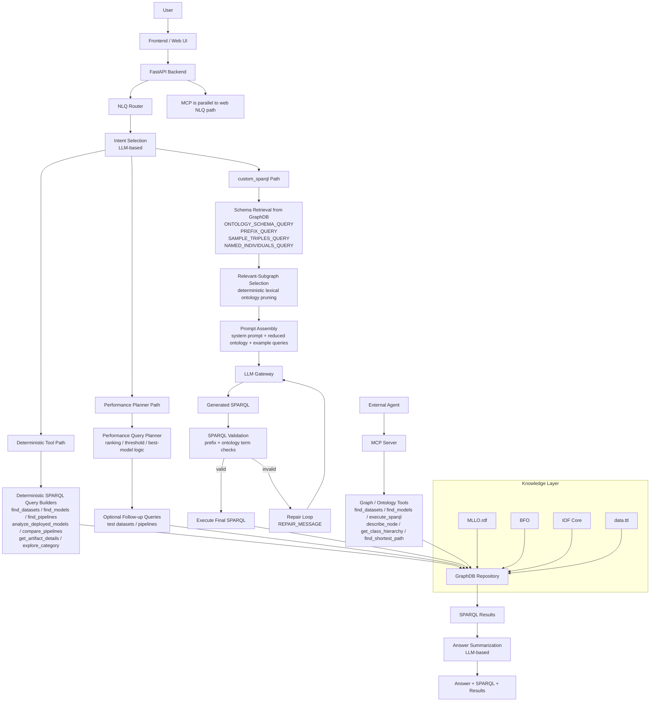
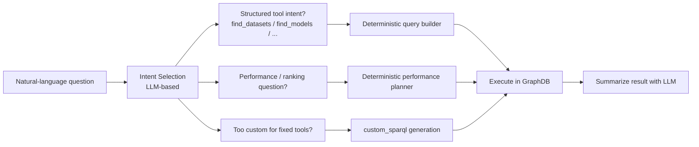
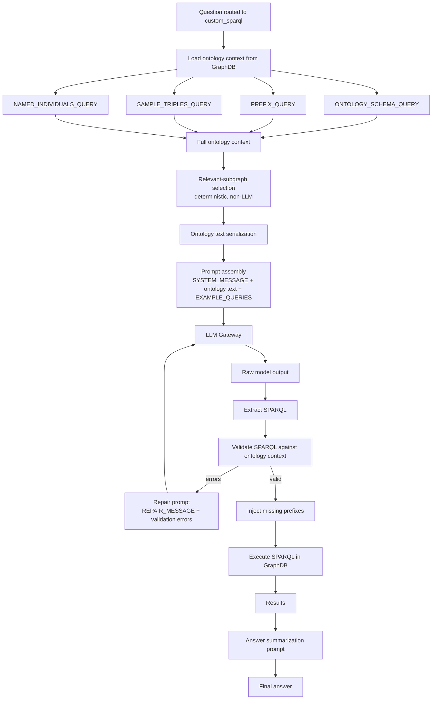

# MLLO-Web Architecture Visualization

## Overall System Flow

## NLQ Decision Flow

## Detailed `custom_sparql` Flow

## Figure Notes

- The deterministic tool path covers most standard user questions and does not require live schema retrieval for prompting.
- The performance planner path can override the original routed intent if the question contains ranking or metric language.
- The `custom_sparql` path is the only path that first queries GraphDB for ontology schema context before asking the LLM to generate SPARQL.
- Relevant-subgraph selection is deterministic code, not an LLM step.
- MCP is a parallel agent-facing interface to the same GraphDB-backed functionality, not an internal step in the FastAPI NLQ pipeline.
